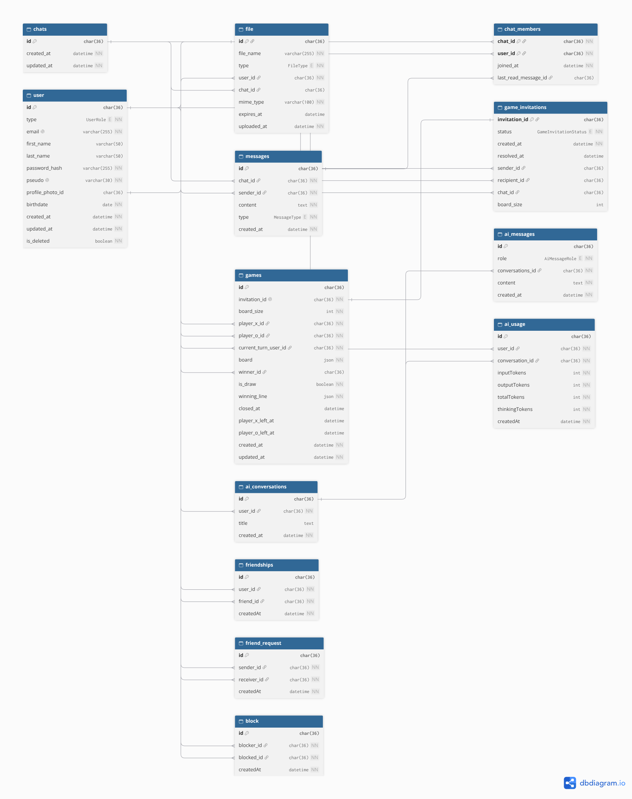

# LinkPlay

_This project has been created as part of the 42 curriculum by chhoflac, oklimov, nmagomad, mknoll._

## Description

**ft_transcendence** is a desktop-based messaging and social networking application inspired by modern mobile messenger apps. The project extends the core messaging experience with additional social, AI, gaming, and analytics features.
The main goal was to create a central platform where users can communicate with each other, interact through social network features, use an integrated Google Gemini chatbot, and play multiplayer games directly within chats.
Key Features

- Real-time messaging between users
- Social networking features for user interaction
- Multiplayer games integrated into chats
- AI chatbot powered by Google Gemini
- Analytics dashboards for monitoring AI usage and viewing detailed game history

The project combines these features into a single application, with the goal of providing a more interactive experience than a traditional messaging platform.

## Instructions

### Prerequisites

The project runs entirely using Docker. Before starting the application, make sure the following is installed and available:

- **Docker Engine**
- **Docker Compose**

Make sure the **Docker Engine is running** before starting the project.

### Installation & Execution

Clone the repository and navigate into the project directory:

```bash
git clone <repository-url>
cd ft_transcendence
```

Start the application using the provided Makefile:

```bash
make
```

Once the containers have been built and started, the application is available at:

```text
https://localhost:8443
```

Open the URL in your browser to access the application.

## Configuration and Setup

The application is configured using Docker Compose and environment variables. Before starting the application, create the required directories and configuration files inside `./srcs/docker`.

### Directory Structure

Create the following directory structure:

```text
srcs/
└── docker/
    ├── .env
    ├── .env.example
    ├── accounts/
    │   └── admin_password.txt
    ├── mariadb/
    │   ├── mariadb_password.txt
    │   └── mariadb_root_password.txt
    └── certs/
        ├── init_certs.sh
        ├── transcendance.crt
        └── transcendance_private.key
```

### 1. Environment Variables

Create a `.env` file inside `./srcs/docker/` using `.env.example` as a template.

```bash
cd srcs/docker
cp .env.example .env
```

Configure all required environment variables according to the descriptions provided in `.env.example`.

### 2. Secrets Configuration

Create the required directories and password files:

```bash
mkdir -p accounts mariadb

touch accounts/admin_password.txt
touch mariadb/mariadb_password.txt
touch mariadb/mariadb_root_password.txt
```

Add a strong password to each file:

- `accounts/admin_password.txt` — password for the application administrator account.
- `mariadb/mariadb_password.txt` — password for the MariaDB application user.
- `mariadb/mariadb_root_password.txt` — password for the MariaDB root user.

Each file should contain only the corresponding password.

### 3. SSL Certificates

Create the `certs` directory and the certificate initialization script:

```bash
mkdir -p certs
touch certs/init_certs.sh
chmod +x certs/init_certs.sh
```

Add the following content to `certs/init_certs.sh`:

```bash
#!/bin/bash

set -e

openssl req -newkey rsa:4096 -x509 -sha256 -days 365 -nodes \
    -keyout ./transcendance_private.key \
    -out ./transcendance.crt \
    -subj "/C=FR/ST=GRAND_EST/L=Mulhouse/O=42Mulhouse/CN=transcendance.fr"
```

The command generates a self-signed SSL certificate and its private key with the following subject information:

| Parameter | Description          | Example            |
| --------- | -------------------- | ------------------ |
| `C`       | Country code         | `FR`               |
| `ST`      | State or region      | `GRAND_EST`        |
| `L`       | City                 | `Mulhouse`         |
| `O`       | Organization         | `42Mulhouse`       |
| `CN`      | Common Name (domain) | `transcendance.fr` |

#### Generate the certificates

Run the script from the `certs` directory:

```bash
cd certs
./init_certs.sh
```

After execution, the following files will be generated:

- `transcendance.crt` — the SSL certificate.
- `transcendance_private.key` — the private key associated with the certificate.

## Team Information

| Team Member  | Role(s)                    | Responsibilities                                                                                                                                  |
| ------------ | -------------------------- | ------------------------------------------------------------------------------------------------------------------------------------------------- |
| **chhoflac** | Product Owner, Developer   | Responsible for defining the project requirements, coordinating the team's priorities, and contributing to the implementation of the application. |
| **mknoll**   | Project Manager, Developer | Responsible for coordinating the development process, organizing tasks and meetings, and contributing to the implementation of the project.       |
| **nmagomad** | Tech Lead, Developer       | Responsible for the overall technical architecture, technology decisions, code quality, and implementation of core features.                      |
| **oklimov**  | Developer                  | Responsible for implementing and maintaining assigned features, fixing bugs, and contributing to the overall development of the application.      |

## Project Management

The team organized the project through a combination of regular meetings and continuous communication.

- **Weekly status meeting:** The team held one status meeting per week to discuss the current progress, review completed tasks, identify problems, and plan the next steps.
- **Task distribution:** Tasks were discussed and distributed among the team members based on the current project priorities and individual responsibilities.
- **Communication:** **Slack** was used for project communication and coordination, while **WhatsApp** was used for more informal and quick communication.

## Technical Stack

### Frontend

The frontend is built with **React** and **TypeScript**, using **Vite** as the development and build tool.

- **React** – Component-based frontend architecture and UI development
- **TypeScript** – Static typing and improved maintainability
- **Vite** – Frontend development and build tooling
- **React Router** – Client-side routing
- **Bootstrap / Sass** – Styling and responsive UI
- **Socket.IO Client** – Real-time communication with the backend
- **Recharts** – Data visualization for analytics dashboards
- **i18next** – Internationalization and multilingual support

### Backend

The backend is built with **Node.js**, **Express**, and **TypeScript**.

- **Node.js** – Server-side JavaScript runtime
- **Express** – HTTP server and REST API
- **TypeScript** – Type-safe backend development
- **Socket.IO** – Real-time communication for messaging, games, and live dashboard interactions
- **Prisma** – Database ORM and migration management
- **JWT** – Authentication
- **bcrypt** – Secure password hashing
- **Zod / express-validator** – Input validation
- **Helmet / CORS / express-rate-limit** – Security and request protection
- **Multer / Sharp** – File and image upload and processing
- **node-cron** – Scheduled backend tasks

### Database

The application uses **MariaDB** as its relational database, accessed through **Prisma**.

MariaDB was chosen because the team already had experience with **MariaDB/MySQL** and because the application's data model benefits from a relational database structure. The application contains many relationships between entities such as users, conversations, messages, and games, making a relational database a suitable choice.

**Prisma** was chosen because it provides strong TypeScript typing, simplifies database access, and provides convenient database migration management.

### Database Schema



### Real-Time Communication

**Socket.IO** is used for bidirectional real-time communication between the frontend and backend.

It is used for features that require immediate updates, including **chat messages, multiplayer games, and live interactions within the analytics dashboards**.

### Artificial Intelligence

The application integrates **Google Gemini** through the `@google/genai` package. The AI functionality provides an integrated chatbot as an additional feature of the messaging platform.

### Containerization

The application is containerized using **Docker**.

Docker was chosen to provide a **consistent development and runtime environment** for the project and to simplify deployment. This allows the application's different components and their dependencies to be run in a controlled and reproducible environment.

## Features List

The following table provides an overview of the implemented features, the team members responsible for their development, and a brief description of their functionality.

| Feature                              | Team Member(s) | Description                                                                              |
| ------------------------------------ | -------------- | ---------------------------------------------------------------------------------------- |
| **Authentication & User Management** | chhoflac       | User registration, login, logout, password management, and account handling.             |
| **User Profiles**                    | chhoflac       | Creation and management of user profiles and profile information.                        |
| **Messaging**                        | nmagomad       | Real-time communication between users through individual or group conversations.         |
| **Social Features**                  | nmagomad       | Social interactions between users, such as adding friends or managing connections.       |
| **AI Chatbot**                       | mknoll         | Integration of Google Gemini to provide an AI-powered chatbot within the application.    |
| **Web-based game**                   | oklimov        | Real-time multiplayer gameplay integrated into the messaging platform.                   |
| **Analytics Dashboard**              | mknoll         | Visualizes application data, including AI usage and game-related statistics.             |
| **File / Image Uploads**             | chhoflac       | Allows users to upload and manage supported files or images.                             |
| **Internationalization**             | chhoflac       | Provides support for multiple languages within the application.                          |
| **Security**                         | everyone       | Implements authentication, input validation, rate limiting, and other security measures. |

## Modules

**Major - Use a framework for both the frontend and backend (2 Points):**

- Everyone of us used both Frameworks. This Module is justified for simplicity and security purposes, to have an easy communication between frontend and Backend

**Major - Implement real-time features using WebSockets (2 Points):**

- Everyone of us used WebSockets. We wanted to use WebSockets to enable real-time communication across the platform. Each module uses sockets to handle real-time interactions, allowing users to receive updates instantly without refreshing the page

**Major - Allow Users to interact with other users (2 Points):**

- This feature was implemented by _nmagomad_. Nowadays, almost every online service and social network has a chat system that allows users to communicate in real time. I wanted to understand how these systems work and how real-time communication is implemented. I was also interested in how user profiles and friend systems work together to create a more interactive social network, where users can connect with each other, discover new people, and manage their friendships.

**Minor - Use an ORM for the database (1 Point):**

- This feature was implemented by _nmagomad_. I wanted to use an ORM to make working with the database easier, safer, and more efficient. Instead of writing raw SQL queries for every database operation, an ORM allows developers to interact with the database using objects and models in their programming language. I was interested in learning how ORMs simplify database management, help prevent common security issues such as SQL injection, and make the code easier to maintain as the project grows.

**Minor - File Upload and management system (1 Point):**

- This feature was implemented by _chhoflac_. Users can upload a profile picture and share files (images, PDF, Word, Excel, PowerPoint) in their conversations. I chose this module because file upload is one of the most common attack surfaces of a web application, and I wanted to understand how to handle it safely. The client is never trusted: the real file type is checked from its magic bytes, images are re-encoded with sharp, files are renamed with random UUIDs, and size limits and type whitelists are enforced on both the frontend and the backend. Access is restricted (only chat members can download a shared file, only its owner can delete it), deletions are synchronized in real time through WebSockets, and expired chat files are automatically cleaned up by a cron job.

**Minor - Support for Multiple Languages (1 Point):**

- This feature was implemented by _chhoflac_. The whole application is available in five languages: English, French, German, Russian and Ukrainian, using i18next. I wanted our platform to be accessible to users who don't speak English, and I found it interesting to see how an application can be designed from the start so that no text is hardcoded. The selected language is remembered between visits, English is used as a fallback if a translation is missing, and the backend only returns error codes, which are then translated on the frontend so that every error message appears in the user's language.

**Major - Standard user Management and Authentication (2 Points):**

- This feature was implemented by _chhoflac_. I wanted to understand how authentication really works behind a simple login form, and how to protect user accounts against the most common attacks. Users can register with an avatar, log in and log out, view their own profile and other users' profiles, edit their information and profile picture, search for other users, and see their friends' online status in real time. Passwords are hashed with bcrypt, sessions use a JWT stored in an httpOnly, secure and sameSite cookie, the login is protected against brute force (rate limiting) and against timing attacks, and every input is validated on the backend, with consistent HTTP error codes.

**Major - Implement a complete LLM system Interface (2 Points):**

- This feature was implemented by _mknoll_.
  I wanted to have a Chatbot in our social Network, with whom the user could talk to. This was done by using the Gemini API.
  As today nearly all websites have their own chatbot, I found it interesting to see how these are implemented and how you can manage them.

**Major - Implement a complete web-based game (2 Points):**

- This feature was implemented by _oklimov_. I implemented a complete web-based version of Gomoku, allowing users to play directly in browser. This module was chosen because it combines both frontend and backend development challenges. It was interesting to implement the game logic, manage real-time interactions, and create a responsive user interface. Through this module I gained a better understanding of state management, user interaction handling, and game development concepts in a web environment.

**Major - Remote Players (2 Points):**

- This feature was implemented by _oklimov_. Users can invite each other and play together in real time, with game actions being synchronized through WebSockets. I found this module particularly interesting because it introduced the challenges of real-time communication and synchronization between different clients. Implementing invitations, connection management, move validation, and handling player disconnections helped me better understand how modern online multiplayer applications are built and maintained.

**Minor - Advanced chat features (1 Point):**

- This feature was implemented by _nmagomad_. I wanted to add more functionality to the chat system and make it more interactive and convenient for users. I found it interesting to explore how additional features could improve the communication experience and make the chat more than just a basic messaging system.

**Major - Advanced analytics dashboard (2 Points):**

- This feature was implemented by _mknoll_.
  In Our Project we store a lot of different data, from the game as well as the AI Chatbot. I wanted to have a Analytics Dashboard for the user to see, his or her gamestats as well as AI usage.
  This was done mainly by using the Recharts library. The library gives us access to all different kind of charts, as react components which are simple to use and easy to Implement.

**Total: 20 points**

## Individual Contribution

### chhoflac

- **Role:** Product Owner, Developer
- **Contributions:** User management, file management, internationalization, login / registration, online status, user search, SCSS / Bootstrap and responsive design.
- **Challenges:** Learning how React and Express work, since I'm more of a JS + PHP web developer. Organization was also an issue for me, and securing file uploads was hard to understand. I solved it by breaking the work into small steps and studying each security layer (magic bytes, re-encoding, access control) one at a time.

### mknoll

- **Role:** Project Manager, Developer
- **Contributions:** Implementation of Analytics Dashboard and LLM system Interface
- **Challenges:** The Challenge of making sure that, the data a fetch from my colleagues table, is in the same format so I can use it. **Key takeaway** is clear communication and keeping everyone updated

### nmagomad

- **Role:** Tech Lead, Developer
- **Contributions:** I contributed to the backend architecture and ORM integration, implementing the messaging system and social features.
- **Challenges:** The challenge of organizing the backend architecture and ensuring that messaging and social features work correctly together. Key takeaway is clean architecture

### oklimov

- **Role:** Developer
- **Contributions:** Developed the Gomoku game for local and online play, including game in chat invitations, real-time moves, match history, and rematches.
- **Challenges:** Keeping the board and turn state consistent for both online players; handled this with server-validated moves and Socket.IO game-state updates.

## Resources

### Links

- https://recharts.github.io/en-US/guide/
- https://www.prisma.io/docs/orm
- https://ai.google.dev/gemini-api/docs
- https://expressjs.com/
- https://react.dev/learn
- https://www.i18next.com/
- https://socket.io/
- https://vite.dev/guide/
- https://www.typescriptlang.org/docs/
- https://getbootstrap.com/docs/5.3/getting-started/introduction/
- https://express-validator.github.io/docs/
- https://zod.dev/

### AI Usage

In this project, AI was used to:

- Debugging: Identify errors, troubleshoot issues, and suggest solutions to improve code reliability.
- Tutoring: Explain technical concepts, clarify unfamiliar technologies, and support the learning process.
- Documentation Enhancement: Improve documentation clarity, structure, and readability.
